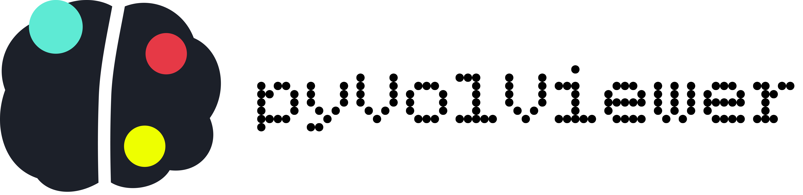
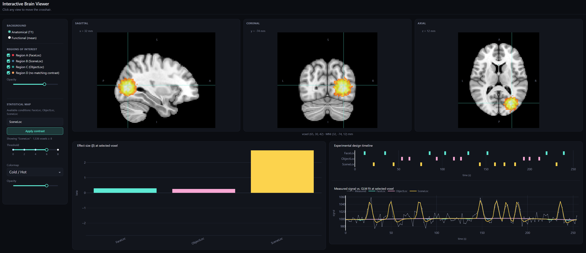

<div align="center">



**An interactive, pure-Python viewer for brain imaging data.**
One background image, any number of ROI and statistical-map overlays, and a live GLM explorer — all in your browser, all in Python.

[](https://www.python.org/)
[](https://dash.plotly.com/)
[](https://nilearn.github.io/)
[](LICENSE)

[Quickstart](#-quickstart) ·
[Features](#-features) ·
[Using your own data](#-using-your-own-data) ·
[Architecture](#-architecture) ·
[Contributing](#-contributing)

</div>

<br>



<br>

## What is this?

**pyVolViewer** is a fast, modular [Dash](https://dash.plotly.com/) application for interactively exploring brain imaging data: one anatomical or functional image in the background, any number of ROI masks and/or a GLM statistical map layered on top, and an optional panel showing per-condition effect sizes, the experimental design timeline, and the measured-vs-fitted signal — all updating live as you click around the brain.

It runs entirely in your browser, entirely from Python.

```bash
python run.py --demo
```

gets you a running app with a real anatomical template and a synthetic-but-coherent dataset — activations, ROIs, conditions, timeline, all consistent with each other — generated entirely offline. No data of your own required to try it.

<br>

## ✨ Features

- 🧩 **One background, any number of overlays.** Pick an anatomical or mean functional image as the background, then layer on any number of ROI masks and (optionally) a GLM contrast, each independently toggleable, colored, and adjustable for opacity/threshold. ROIs and statistical maps are the same underlying abstraction (`OverlayLayer`), so they compose freely.
- ⚡ **Fast.** A full click — recomposing all three orthogonal views and shipping them to the browser — takes about **50 ms**.
- 🧭 **Correct, verified orientation.** Left/right/anterior/posterior/superior/inferior labeling was checked with an automated test against a synthetic marker at a known location, not just eyeballed.
- 📈 **A live GLM explorer.** Type a contrast expression, see the statistical map update; click a voxel, see its per-condition effect sizes, the experimental design timeline, and the measured signal against each condition's fitted contribution — all colored consistently across panels.
- 🧪 **A real, offline demo dataset.** `--demo` uses nilearn's bundled MNI152 template as a real anatomical background, with synthetic activation that actually colocalizes with its matching ROI — that's a regression test, not just a claim.
- 🛠️ **Modular and documented.** Every module has a single, clearly-stated job; every public function has a NumPy-style docstring.

<br>

## 🚀 Quickstart

```bash
git clone https://github.com/alireza-kr/pyVolViewer.git
cd pyVolViewer
pip install -r requirements.txt
python run.py --demo
```

Then open **http://127.0.0.1:8050**. Click anywhere on any of the three views to move the crosshair — the other two views, the coordinate readout, and the beta bar chart all follow. Toggle ROIs and switch backgrounds from the sidebar. Type a contrast expression (e.g. `FaceLoc - SceneLoc`) and click **Apply contrast** to see a different statistical map.

Requires Python 3.10+. See [`requirements.txt`](requirements.txt) for exact package versions tested against.

<br>

## 🧠 Using your own data

### From the command line

```bash
python run.py \
    --anat sub-01_desc-preproc_T1w.nii.gz \
    --func sub-01_task-loc_desc-preproc_bold.nii.gz \
    --model sub-01_glm.pkl \
    --events sub-01_events.tsv \
    --roi left_ffa.nii.gz --roi right_ffa.nii.gz \
    --contrast "Face - House" --threshold 3.1
```

`--anat`/`--func` accept any NIfTI nilearn can load. `--model` is a `nilearn.glm.first_level.FirstLevelModel` saved with `joblib.dump`. `--roi` can be repeated for multiple masks. Run `python run.py --help` for the full list.

### From Python

This is the more flexible path — use it if you want to load a model you already have in memory, split an atlas into per-region ROIs, or otherwise do anything the CLI doesn't expose directly.

```python
from interactive_glm.app import create_app
from interactive_glm.config import RoiSource, ViewerSettings
from interactive_glm.data.loading import load_brain_data

data = load_brain_data(
    anat="sub-01_T1w.nii.gz",
    func="sub-01_bold.nii.gz",
    glm_model="sub-01_glm.pkl",       # or an already-fitted model object
    events="sub-01_events.tsv",       # or a pandas.DataFrame
    rois=[
        RoiSource(img="left_ffa.nii.gz", label="Left FFA", color="#e63946"),
        RoiSource(img="right_ffa.nii.gz", label="Right FFA"),  # color auto-assigned
    ],
)

settings = ViewerSettings(default_contrast="Face - House", default_threshold=3.1)
app = create_app(data, settings)
app.run(debug=False)
```

`anat` and `func` are both optional individually, but at least one is required — whichever you provide (or both) becomes a background option. Everything else (`glm_model`, `events`, `rois`) is independently optional too; see the docstring of `load_brain_data` for the full parameter list.

### Loading ROIs from an atlas

```python
from nilearn.datasets import fetch_atlas_harvard_oxford
from interactive_glm.data.loading import split_atlas

atlas = fetch_atlas_harvard_oxford("cort-maxprob-thr25-2mm")
rois = split_atlas(atlas.maps, labels=dict(enumerate(atlas.labels)))
data = load_brain_data(anat="sub-01_T1w.nii.gz", rois=rois)
```

`split_atlas` turns an integer-labeled image into one `RoiSource` per region (skipping label 0 as background), which then flows through exactly the same loading and rendering path as any other ROI.

<br>

## 🏗️ Architecture

```
interactive_glm/
├── config.py               # every shared data structure (start here)
├── app.py                  # create_app(data, settings) -> Dash
├── data/                   # your files, or the offline demo -> aligned BrainData
├── processing/              # pure functions: arrays/images in, arrays/images out
├── figures/                  # arrays -> plotly.graph_objects.Figure
├── components/                # figures/data -> Dash layout (no callbacks)
├── callbacks/                  # the interactive behaviour
└── assets/style.css
```

The guiding idea is a strict one-way dependency chain — `data` depends on `processing`; `figures` depends on `processing`; `components` depends on `figures`; `callbacks` depends on all of the above. The compositing code, for instance, has no idea Dash exists, and is fully unit-tested and reusable on its own (e.g. from a notebook).

<br>

## 🧪 Testing

```bash
pip install -r requirements.txt pytest
pytest
```

55 tests, ~15–20 seconds. Highlights include an empirical check of display orientation against a synthetic marker at a known location, and an end-to-end coherence check that synthetic activation actually colocalizes with its matching ROI.

<br>

## 🤝 Contributing

Issues and pull requests are welcome — whether it’s bug reports, new overlay types, additional colormaps, or anything else you think would improve the project.

<br>

## 📄 License

[CC0 1.0 Universal](LICENSE) — public domain dedication. Use it, modify it, redistribute it, for any purpose, without asking.

<br>

## 📖 Citation

If pyVolViewer is useful in your research, please cite it — citations are how tool authors get credit in academic contexts, and how funders/departments see the impact of the time spent building tools like this one.

[](https://doi.org/10.5281/zenodo.23621837)

```bibtex
@software{pyVolViewer,
  author  = {Karami, Alireza},
  title   = {pyVolViewer: an interactive Python viewer for brain imaging data},
  year    = {2026},
  publisher = {Zenodo},
  doi     = {https://doi.org/10.5281/zenodo.23621837},
  url     = {https://github.com/alireza-kr/pyVolViewer}
}
```

<br>

## 🙏 Acknowledgments

Built on [nilearn](https://nilearn.github.io/) (GLM fitting, resampling, neuroimaging colormaps), [Dash and Plotly](https://plotly.com/dash/) (the app framework and rendering), and [nibabel](https://nipy.org/nibabel/) (NIfTI I/O). The demo dataset's anatomical background is the real MNI152 template bundled with nilearn.

<div align="center">
<sub>Brain scans are complicated. This viewer doesn't have to be.</sub>
</div>
